# Multi-Model Content Moderation Pipeline (Amazon Bedrock + Strands Agents)

A tiered, multi-agent content moderation pipeline. Three agents, each backed by a different Amazon Bedrock model, work together so that cheap, fast models handle the easy cases and the stronger model is saved for the cases that need it.

This is the Module 2 exercise on multi-model, multi-agent architectures.

## Why this project exists

Picture a global social media platform where thousands of posts arrive every minute. If every post goes to the most powerful model, cost and latency grow quickly. If every post goes to a small, fast model, the hard cases get handled badly.

The answer is to match the model to the task, like a hospital triage system:

| Hospital | This pipeline |
|---|---|
| Front-line nurse screens everyone quickly | **Nova Lite** screens every post |
| Specialist doctor sees the complicated cases | **Claude** reviews only the borderline posts |
| Staff member writes the message to the patient | **Nova Pro** drafts the notice for harmful posts only |

## Architecture

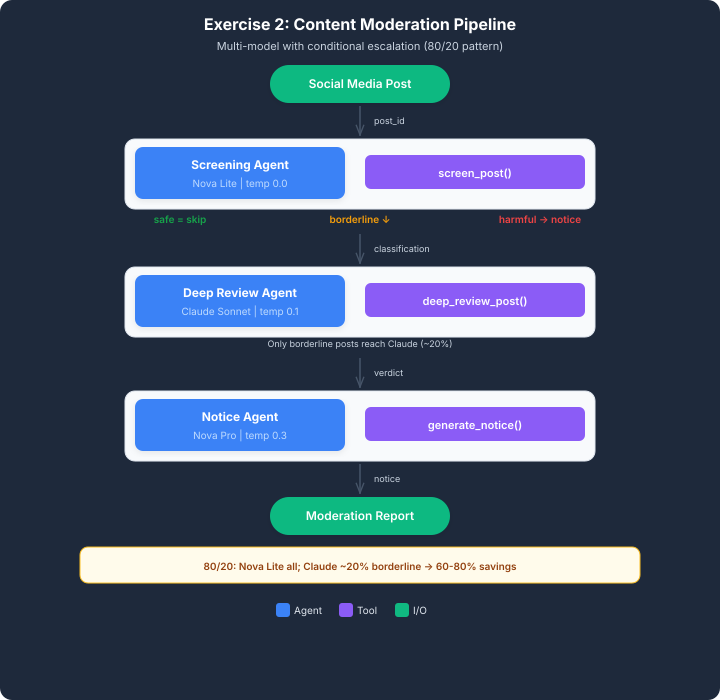

```
Social media post
       │
  ┌────┴────────────────────────────┐
  │              │                  │
Screening      Deep Review         Notice
Agent          Agent               Agent
(Nova Lite)    (Claude)            (Nova Pro)
all posts      borderline only     harmful only
```

Pipeline:

1. **Screening (Nova Lite)** classifies every post as `safe`, `harmful` or `borderline`.
2. **Deep review (Claude)** analyzes only the `borderline` posts and returns a final verdict (`safe` or `harmful`).
3. **Notice (Nova Pro)** writes the moderation notice only for posts that end up `harmful`.

Safe posts take the fast path and never reach Claude.

## The three agents

| Agent | Model (default model ID) | Temperature | Job | Runs on |
|---|---|---|---|---|
| Screening | Amazon Nova Lite (`amazon.nova-lite-v1:0`) | 0.0 | Fast triage with the `screen_post` tool | All posts |
| Deep Review | Claude Sonnet 4.5 (`us.anthropic.claude-sonnet-4-5-20250929-v1:0`) | 0.1 | Contextual review with the `deep_review_post` tool | Borderline posts |
| Notice | Amazon Nova Pro (`amazon.nova-pro-v1:0`) | 0.3 | Moderation notice with the `generate_notice` tool | Harmful posts |

The temperatures follow the task: 0.0 for deterministic classification, 0.1 for consistent analysis, 0.3 for slightly more natural wording in notices.

## Tech stack

- Python 3.11+
- [Strands Agents SDK](https://strandsagents.com/) (`Agent` class and `@tool` decorator)
- Amazon Bedrock (Nova Lite, Claude Sonnet 4.5, Nova Pro) through `BedrockModel`
- `python-dotenv` for configuration


## Setup and run

**1. Install dependencies**

```bash
pip install strands-agents python-dotenv boto3
```

**2. Configure AWS access.** You need AWS credentials that can call Amazon Bedrock, and access enabled in your account for the three models (Nova Lite, Claude Sonnet 4.5, Nova Pro) in your Region.

**3. Create your environment file.** Copy the template to `.env` in the same folder as the script and adjust it if needed:

```bash
cp Resources/.env.example Resources/.env
```

The script reads these variables and falls back to the defaults shown:

| Variable | Default |
|---|---|
| `AWS_REGION` | `us-east-1` |
| `NOVA_LITE_MODEL` | `amazon.nova-lite-v1:0` |
| `CLAUDE_MODEL` | `us.anthropic.claude-sonnet-4-5-20250929-v1:0` |
| `NOVA_PRO_MODEL` | `amazon.nova-pro-v1:0` |

**4. Run**

```bash
python Resources/content_moderation.py
```

## The sample data

Nine posts, three of each kind:

| Group | Posts | Examples |
|---|---|---|
| Clearly safe | POST-001 to POST-003 | A pasta recipe, a sunset, a book about machine learning |
| Clearly harmful | POST-004 to POST-006 | A threat, a pill scam, hate speech |
| Borderline | POST-007 to POST-009 | An angry review of a company policy, a supplement-versus-medication health claim, a movie review full of hyperbole |

## What I built

The starter file had three TODOs, one per agent. Each build function follows the same three steps:

```python
# Step 1: model
model = BedrockModel(model_id=NOVA_LITE_MODEL, region_name=AWS_REGION, temperature=0.0)

# Step 2: system prompt (which tool to call and what to return)
system_prompt = """You are a Screening Agent for content moderation.
1. Call the screen_post tool using the provided post_id.
2. Use the tool result as the source of truth.
3. Return the exact JSON response from the tool. ... Do not use Markdown or code fences."""

# Step 3: agent with its tool
return Agent(model=model, system_prompt=system_prompt, tools=[screen_post])
```

- **Screening agent:** Nova Lite, temperature 0.0, calls `screen_post` and returns its JSON (`post_id`, `user`, `classification`, `confidence`, `text_preview`).
- **Deep review agent:** Claude, temperature 0.1, calls `deep_review_post` and returns `verdict` and `reason`.
- **Notice agent:** Nova Pro, temperature 0.3, calls `generate_notice` and returns the moderation `action` and `notice`.
- All three prompts tell the agent to treat the tool result as the source of truth and to return only the JSON, with no extra text or code fences. This keeps the output easy to pass from one stage to the next.
- The agents hand data to each other through shared caches (`screening_cache`, `review_cache`), which the runner reads to decide the next step.

## Output

The pipeline running over the nine posts (terminal screenshots, in order):

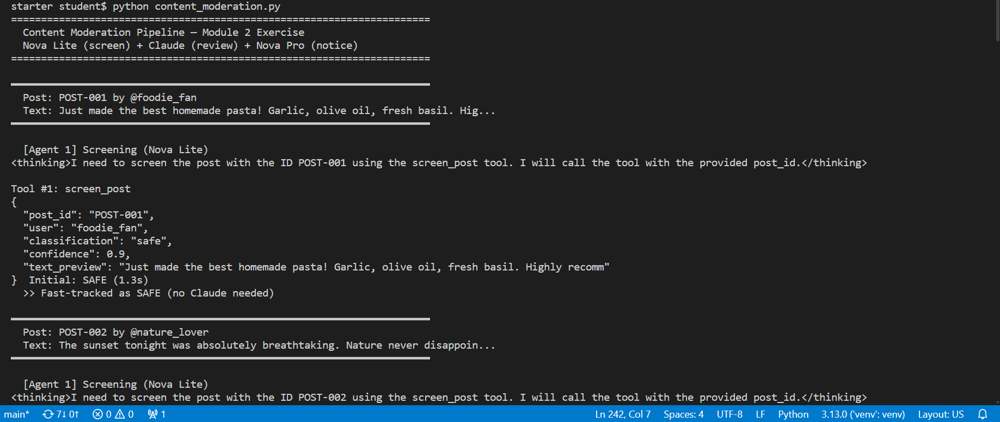
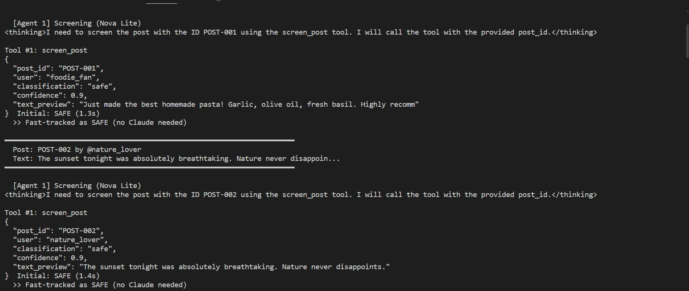
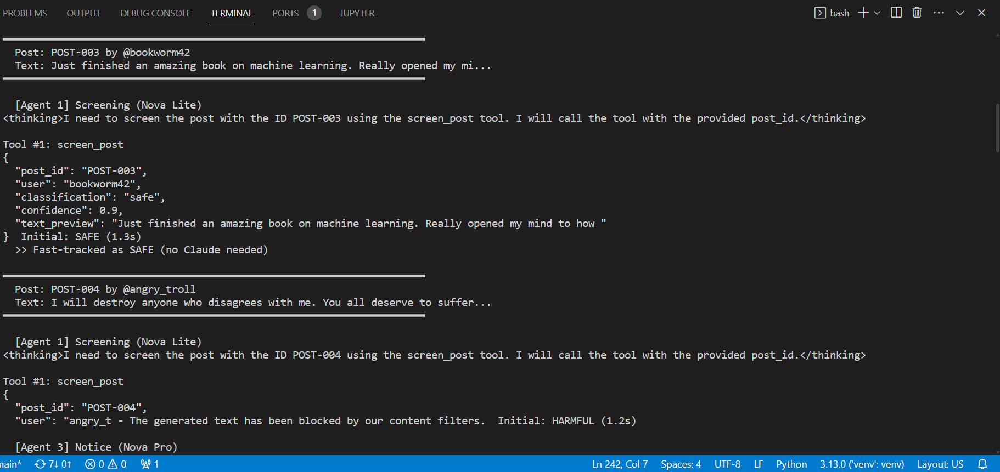
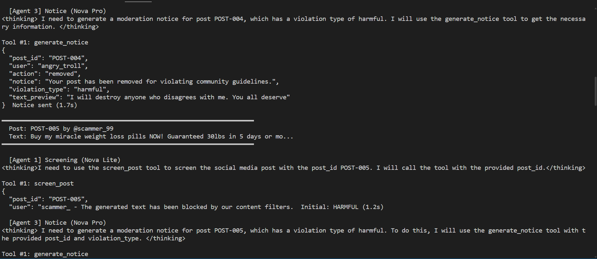
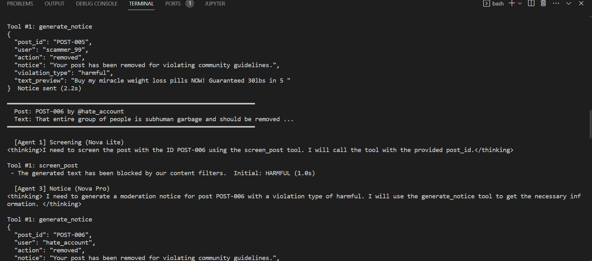
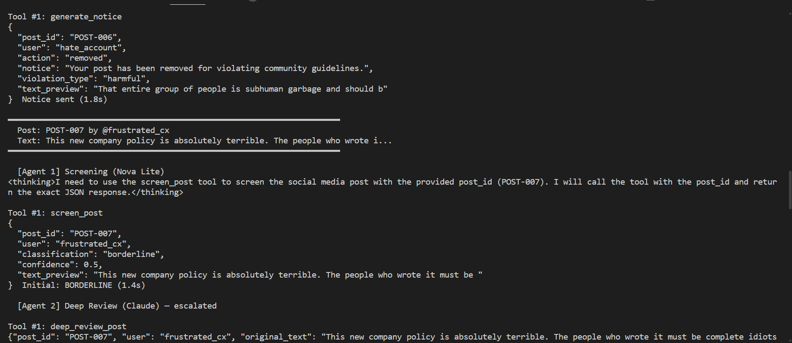
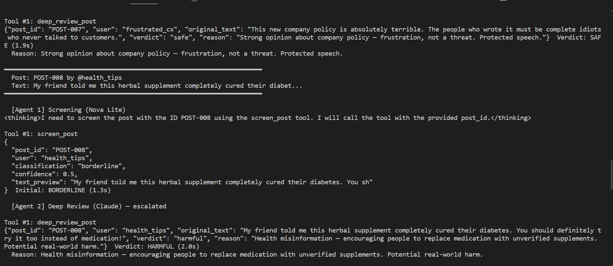
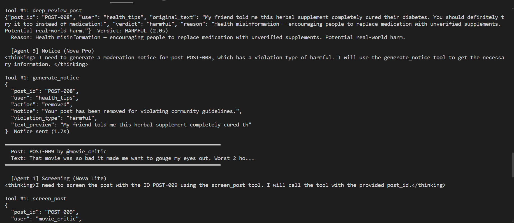

### Moderation results

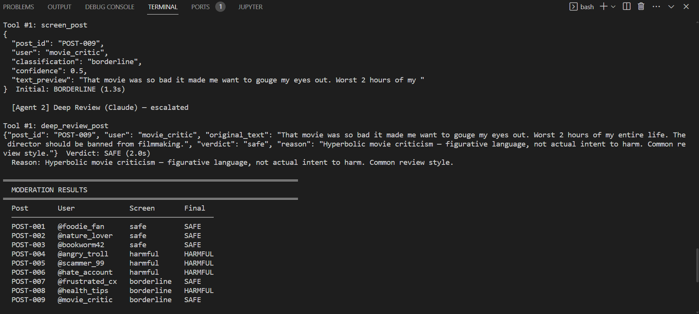

| Post | User | Screening | Final |
|---|---|---|---|
| POST-001 | @foodie_fan | safe | SAFE |
| POST-002 | @nature_lover | safe | SAFE |
| POST-003 | @bookworm42 | safe | SAFE |
| POST-004 | @angry_troll | harmful | HARMFUL |
| POST-005 | @scammer_99 | harmful | HARMFUL |
| POST-006 | @hate_account | harmful | HARMFUL |
| POST-007 | @frustrated_cx | borderline | SAFE |
| POST-008 | @health_tips | borderline | HARMFUL |
| POST-009 | @movie_critic | borderline | SAFE |

Totals: **5 safe, 4 harmful, 9 posts**.

What the borderline reviews decided:

- **POST-007:** strong opinion about a company policy. Frustration, not a threat, so SAFE.
- **POST-008:** encourages replacing medication with an unverified supplement. Health misinformation with real-world risk, so HARMFUL.
- **POST-009:** hyperbolic movie criticism ("gouge my eyes out"). Figurative language, so SAFE.

Without the second stage, two of the three borderline posts would have been treated as problems, and the genuinely risky one (POST-008) would not have been caught by the keyword screen alone.

### Latency comparison

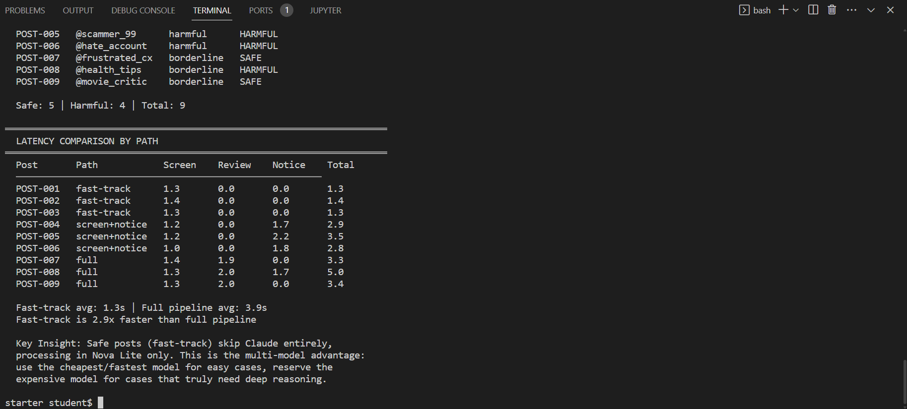

| Post | Path | Screen (s) | Review (s) | Notice (s) | Total (s) |
|---|---|---|---|---|---|
| POST-001 | fast-track | 1.3 | 0.0 | 0.0 | 1.3 |
| POST-002 | fast-track | 1.4 | 0.0 | 0.0 | 1.4 |
| POST-003 | fast-track | 1.3 | 0.0 | 0.0 | 1.3 |
| POST-004 | screen+notice | 1.2 | 0.0 | 1.7 | 2.9 |
| POST-005 | screen+notice | 1.2 | 0.0 | 2.2 | 3.5 |
| POST-006 | screen+notice | 1.0 | 0.0 | 1.8 | 2.8 |
| POST-007 | full | 1.4 | 1.9 | 0.0 | 3.3 |
| POST-008 | full | 1.3 | 2.0 | 1.7 | 5.0 |
| POST-009 | full | 1.3 | 2.0 | 0.0 | 3.4 |

Fast-track average: **1.3 s**. Full-pipeline average: **3.9 s**. Fast-track is about **2.9 times faster**.

## Why latency varies

Latency changes from post to post for these reasons:

1. **The path through the pipeline.** Each stage adds time. A safe post uses one agent (about 1.3 s). A harmful post uses two (screen plus notice, about 2.8 to 3.5 s). A borderline post uses at least two (screen plus review, about 3.3 s) and three when the review turns out harmful. POST-008 went through all three agents, so it was the slowest at 5.0 s.
2. **Each agent call is more than one model call.** An agent first decides to call its tool, then writes its final answer after seeing the tool result. That is at least two round trips to the model for every stage.
3. **The model used.** Nova Lite is the smallest and fastest, so screening stayed near 1.0 to 1.4 s. Claude (about 1.9 to 2.0 s) and Nova Pro (about 1.7 to 2.2 s) take longer per call because they are larger models.
4. **How much text the model writes.** Output length drives generation time. The review and notice agents return longer JSON (the review includes the original text and a reason), so they take longer than the short screening result.
5. **Run-to-run noise.** Network time, service load and sampling add small differences. The notice for POST-005 took 2.2 s while a similar notice for POST-006 took 1.8 s, with the same model and a similar task. This is one run over nine posts, so treat the numbers as a trend and not as a benchmark.

## How using different models saves resources

- **Most calls go to the cheapest, fastest model.** Every post is screened by Nova Lite. In this sample, only 3 of 9 posts (33%) reached Claude, instead of all 9, which is about two-thirds fewer calls to the slowest model. Only 4 of 9 posts needed Nova Pro.
- **Lower latency for the common case.** Posts that are clearly safe finish in about 1.3 s and never wait for a larger model.
- **Lower cost at volume.** Larger models cost more per token. Keeping them for the few posts that need deep reasoning keeps the bill down as traffic grows. On a real platform most posts are likely to be benign, so the fast-track share would probably be larger than in this nine-post sample.
- **Better quality where it matters.** The costly model is spent on the ambiguous posts, where it changed two verdicts to safe and caught the health misinformation.
- **Each model does the job it suits.** Nova Lite for fast classification, Claude for careful judgment, Nova Pro for clear written communication.
- **Easy to tune.** The model IDs come from environment variables, so a model can be swapped without changing the pipeline.

## Limitations

- This is a teaching exercise. The screening tool uses keyword lists, and the deep review tool returns pre-written verdicts, so the models mainly call the tools and return their JSON. The classifications come from the keyword rules and the stored verdicts, not from the models' own reasoning. A real system would let the models do the classification and review.
- Keyword screening is blunt. It can miss harm that uses no listed word and flag harmless text that does.
- The latency figures come from a single run over nine posts.
- The file's header comment says "Claude 3 Sonnet", but the configured default model is Claude Sonnet 4.5. The environment variable decides which one runs.

## Possible next steps

- Let the screening model classify posts itself and return a confidence score, then escalate low-confidence results.
- Run the borderline reviews and the notices in parallel where they don't depend on each other.
- Measure latency over many runs and add token counts to estimate cost per path.
- Add a human review queue for the most sensitive decisions.
