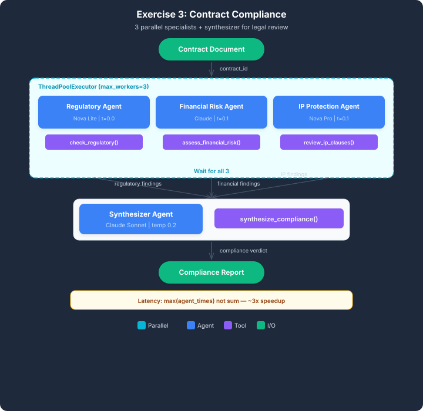
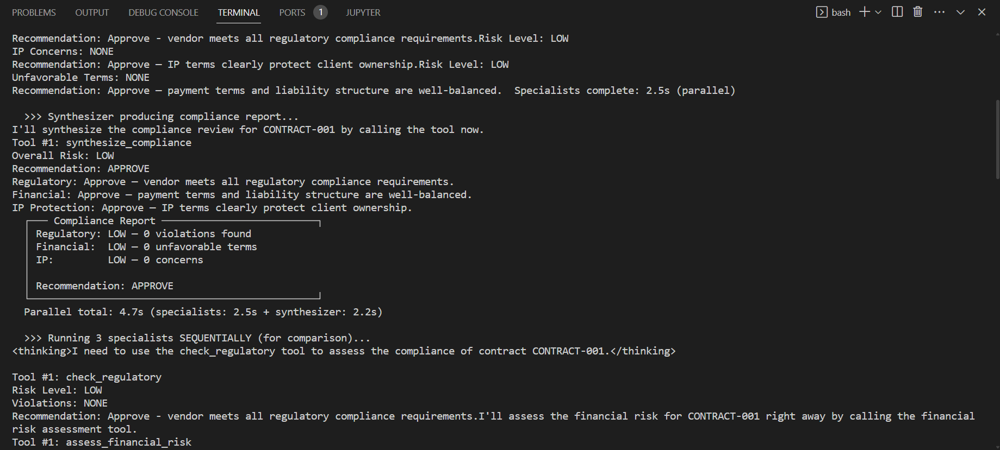
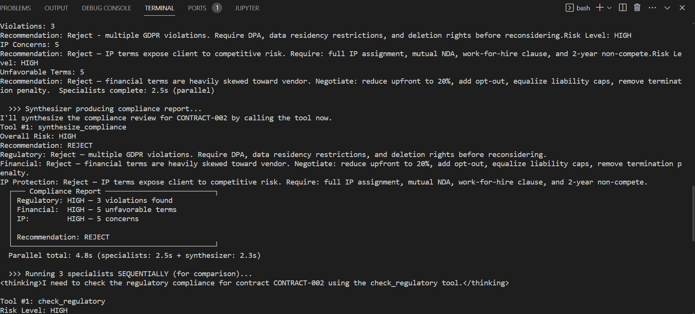
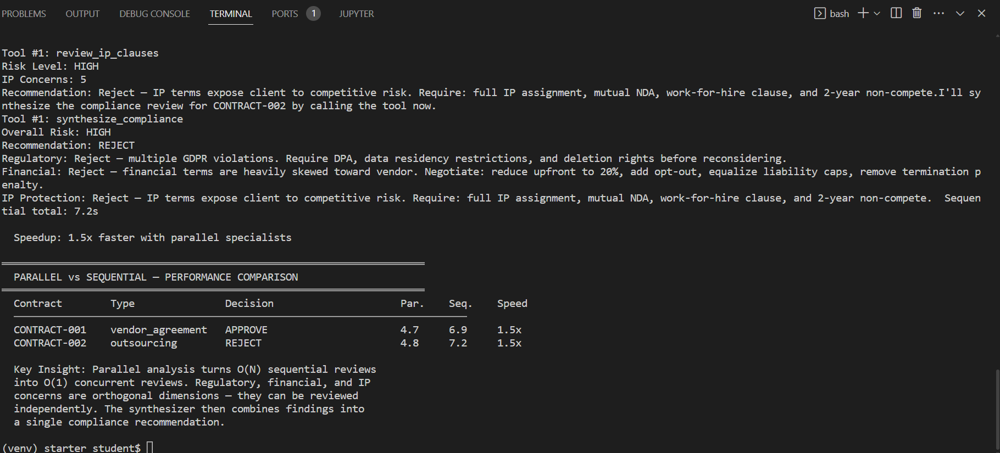

# Multi-Agent Contract Compliance Analysis

A multi-agent contract compliance system built with **Strands Agents** and **Amazon Bedrock**. The project uses multiple specialist agents to independently assess different aspects of a contract, then combines their findings into a unified compliance recommendation.

## Overview

Reviewing a contract involves checking several areas, including regulatory requirements, financial risks, and intellectual property protection.

Instead of asking one agent to perform every task sequentially, this project uses multiple specialist agents that can work independently and in parallel. A Synthesizer Agent then combines their assessments to produce an overall compliance decision.

## Architecture



The system consists of four agents:

| Agent | Model | Responsibility |
|---|---|---|
| Regulatory Agent | Amazon Nova Lite | Checks regulatory compliance and identifies violations |
| Financial Risk Agent | Claude Sonnet 4.6 | Examines payment terms, liability, indemnification, penalties, and renewal clauses |
| IP Protection Agent | Amazon Nova Pro | Reviews IP ownership, licensing, NDA reciprocity, and non-compete clauses |
| Synthesizer Agent | Claude Sonnet 4.6 | Combines specialist findings into a final compliance recommendation |

### How It Works

1. **Parallel specialist analysis:** The Regulatory, Financial Risk, and IP Protection agents independently analyze the same contract.
2. **Shared results:** Each specialist stores its assessment in a shared Python cache.
3. **Synthesis:** After all three specialists finish, the Synthesizer Agent calls `synthesize_compliance` to retrieve their findings.
4. **Final decision:** The system produces an overall risk level and one of three recommendations:
   - `APPROVE`
   - `APPROVE-WITH-CONDITIONS`
   - `REJECT`

The Synthesizer does not re-analyze the contract. It uses the specialist findings to produce a combined recommendation.

## Parallelization with ThreadPoolExecutor

One of the main learning objectives of this project was understanding how **parallelization using Python's `ThreadPoolExecutor` can reduce execution time when tasks are independent**.

The three specialist agents analyze separate risk domains. Since their assessments do not depend on one another, they can run concurrently instead of waiting for each other to finish.

The coordinator uses `ThreadPoolExecutor` to submit the specialist tasks and collect their results. Once all specialist agents have completed, the Synthesizer runs.

### Parallel vs. Sequential Execution

The project compares the execution time of parallel and sequential processing for two contracts.

| Contract | Type | Decision | Parallel (s) | Sequential (s) | Speedup |
|---|---|---|---:|---:|---:|
| CONTRACT-001 | vendor_agreement | APPROVE | 4.7 | 6.9 | 1.5x |
| CONTRACT-002 | outsourcing | REJECT | 4.8 | 7.2 | 1.5x |

**Performance comparison:**

- CONTRACT-001: Parallel execution reduced processing time from 6.9s to 4.7s.
- CONTRACT-002: Parallel execution reduced processing time from 7.2s to 4.8s.
- Both test cases achieved approximately **1.5x speedup** with parallel execution.

These results demonstrate how independent tasks can benefit from concurrent execution, particularly when agents make separate model calls.

## Project Results

The project includes two contract analysis examples:

- **Case 1:** `CONTRACT-001` — vendor agreement.
- **Case 2:** `CONTRACT-002` — outsourcing contract.

The screenshots below show the individual contract analysis outputs and the performance comparison.

### Case 1 — CONTRACT-001



### Case 2 — CONTRACT-002



### Parallel vs. Sequential Performance



## Project Structure

```text
contract-compliance/
│
├── Resources/
│   ├── contract_compliance.py
│   ├── architecture3.svg
│   ├── contract_compliance_out1.png
│   ├── contract_compliance_out2.png
│   └── contract_compliance_out3.png
│
└── README.md
```

## Technologies Used

- Python
- Strands Agents SDK
- Amazon Bedrock
- Amazon Nova Lite
- Amazon Nova Pro
- Anthropic Claude Sonnet 4.6
- Python `ThreadPoolExecutor`
- `python-dotenv`

## Setup and Configuration


### 1. Create a virtual environment

```bash
python -m venv .venv
```

Activate it:

**Windows PowerShell**

```powershell
.venv\Scripts\Activate.ps1
```

**Linux/macOS**

```bash
source .venv/bin/activate
```

### 2. Install dependencies

```bash
pip install strands-agents boto3 python-dotenv
```

### 3. Configure environment variables

Create a `.env` file in the project root using `.env.example` as a template.

```env
AWS_REGION=us-east-1

NOVA_LITE_MODEL=amazon.nova-lite-v1:0
CLAUDE_MODEL=us.anthropic.claude-sonnet-4-6
NOVA_PRO_MODEL=amazon.nova-pro-v1:0

AWS_ACCESS_KEY_ID=
AWS_SECRET_ACCESS_KEY=
AWS_SESSION_TOKEN=
```

Add your AWS credentials through your authorized AWS account or temporary lab credentials.

**Security note:** Never commit your actual `.env` file, AWS access keys, secret keys, or session tokens to GitHub. Use `.gitignore` to exclude `.env`.

### 4. Run the project

```bash
python Resources/contract_compliance.py
```

Make sure the script's paths and imports match your repository structure.

## Key Learnings

Through this project, I explored several important concepts:

- **Parallel execution:** Using `ThreadPoolExecutor` to execute independent agent tasks concurrently.
- **Performance optimization:** Comparing parallel and sequential execution to understand the benefits of concurrency.
- **Multi-agent architecture:** Dividing a complex contract analysis task into specialized responsibilities.
- **Shared state:** Using Python dictionaries as shared caches to store and retrieve specialist results.
- **Agent orchestration:** Coordinating the execution order so that synthesis begins only after all specialist assessments are complete.
- **Result synthesis:** Combining multiple independent assessments into one structured compliance recommendation.
- **Model selection:** Using different Amazon Bedrock models based on the reasoning requirements of each task.

## Important Notes

This project is an educational demonstration of multi-agent orchestration and contract risk assessment. Its recommendations should not be treated as legal advice or a replacement for professional contract review.
